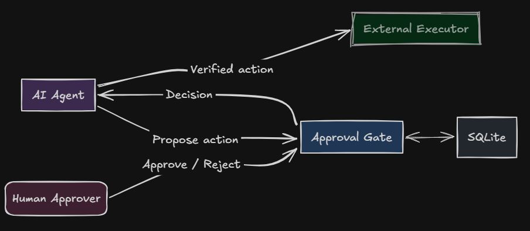

# Async Human Approval Gate

A small Python component that pauses an agent workflow until a human approves or rejects a proposed action. The gate records one durable decision, binds that decision to the exact action payload, and lets the agent resume only after verifying the stored bytes.

The core is dependency-free and uses only the Python standard library. SQLite provides durable storage and real transactions. A terminal Approval Console, a thin CLI, an agent-side bridge, and a FastAPI demo show the two sides of the flow.



- Design: [docs/design.md](docs/design.md)
- Python: 3.11+
- Runtime dependencies: none

## What it guarantees

- **One durable terminal decision per request.** A request ends as `approved`, `rejected`, `expired`, or `cancelled`, never more than once.
- **Approval is bound to the payload.** The action is stored as canonical UTF-8 JSON. Its SHA-256 digest is the authorization token; `verified_action()` re-reads and re-hashes the stored bytes before execution.
- **Retries are idempotent.** Reusing an idempotency key with the identical operation replays the stored outcome. Reusing it for different content raises `IdempotencyConflict`.
- **Expiry fails closed.** At or after the deadline, a late approval becomes an expiry. Overdue requests are never returned as pending.
- **Audit history is append-only.** SQLite triggers reject updates, deletes, and replacement inserts on transitions, plus mutation of immutable request fields.
- **Time, IDs, and sleep are injected.** Tests use a manual clock and fake sleepers, so they never wait on the wall clock.

## What it does not guarantee

- **Exactly-once external execution.** The gate durably records the decision and makes decision retries safe. If an executor crashes after performing a side effect but before recording completion, a retry can perform it again. Use the request ID (or action digest) as the downstream idempotency key.
- **Authentication.** The core treats `requested_by`, `responder`, and `actor` as opaque strings. The CLI values are assertions, and the HTTP demo uses static bearer tokens. Production adapters must authenticate users and derive identities server-side.
- **Multi-approver policy.** V1 supports a single approver. Quorum, delegation, and escalation are deferred.
- **Enforcement against a hostile agent.** The gate coordinates and audits; it does not physically prevent a process with direct access to the system from acting without asking. Put the gate in the agent's tool loop, or run the agent in a sandbox that denies unapproved actions.
- **High-throughput multi-writer operation.** SQLite is a good fit for human-paced approvals, not a general-purpose queue.
- **Encryption at rest.** Protect the SQLite file with filesystem permissions and your platform's disk controls.

## Install

From this checkout:

```bash
uv sync
```

Or install the package with pip:

```bash
python -m pip install .
```

`uv sync` installs the development group too: FastAPI, Uvicorn, HTTPX, Hypothesis, pytest, and pytest-asyncio. The examples live in the repository and are not part of the wheel.

## Quick start: agent and human

The agent proposes an action and waits. A human inspects and decides from another process.

### Agent side

Save this as `agent.py` (a runnable version is in [`examples/agent_tool.py`](examples/agent_tool.py)):

```python
import json
from datetime import timedelta

from approval_gate import (
    ApprovalGate,
    RealAsyncSleeper,
    RealSyncSleeper,
    SqliteStore,
    Status,
    SystemClock,
    UuidIds,
)

clock = SystemClock()
gate = ApprovalGate(
    store=SqliteStore("approvals.db", clock=clock),
    clock=clock,
    ids=UuidIds(),
    sync_sleeper=RealSyncSleeper(),
    async_sleeper=RealAsyncSleeper(),
)

proposal = gate.propose(
    workflow_id="order-1234",
    action={
        "tool": "send_email",
        "to": "customer@example.com",
        "subject": "Your order has shipped",
    },
    summary="Send the shipping notification",
    requested_by="agent:fulfilment",
    ttl=timedelta(hours=1),
    dedupe_key="order-1234-shipping",
)
request = proposal.request
print(f"request={request.id}")
print(f"digest={request.action_digest}")

outcome = gate.wait(request.id, poll_interval=1.0, timeout=300)
if outcome.status is not Status.APPROVED:
    raise SystemExit(f"not approved: {outcome.status} ({outcome.reason})")

verified = gate.verified_action(outcome)
assert verified.action_digest == request.action_digest


def execute(payload: dict) -> None:
    print(f"executing {payload['tool']} -> {payload['to']}")


execute(json.loads(verified.canonical_json))  # execute exactly the verified bytes
```

Run it:

```bash
uv run python agent.py
```

Or run the bundled demo:

```bash
uv run python -m examples.agent_tool
# Self-contained demo: another demo principal approves after one second.
uv run python -m examples.agent_tool --auto-approve
```

### Human side: Approval Console

In another terminal, open the console against the same database. The person running it is the approver; `--as` is the identity recorded in the audit transition.

```bash
uv run python examples/approval_console.py --db approvals.db --as alice@corp
```

Example output (values will differ):

```text
Approval Console
Approver: alice@corp
Database: approvals.db
Type "help" for commands.

approval> pending
Pending approvals:
  1. #2E0C59A7  Send the shipping notification
     order-1234 | agent:fulfilment | in 42m
Use "show N", "approve N", or "reject N <reason>".

approval> approve 1
```

Use the list number, the short reference shown in the inbox (`approve #2E0C59A7`), or the full request ID.

The console renders an approval card with the action fields, the requesting workflow, the deadline, and a short payload fingerprint. It asks for confirmation and then records the decision. You do not type a request ID or a 64-character digest. Use `details` when you want the full ID, full digest, and exact canonical JSON.

```text
approval> show 1
Approval #2E0C59A7
Send the shipping notification
Requested by agent:fulfilment | workflow order-1234
...
Tool: send_email
To: customer@example.com
Subject: Your order has shipped
...
Payload fingerprint: cb5acd52
The agent is waiting and will only resume if approved.

approval> reject 1 The customer asked us to hold it
```

`pending` sweeps expired requests before listing. `show` is a pure read unless the selected request is overdue, in which case the console records the expiry and prints the receipt. `approve` and `reject` are confirmed, idempotent gate calls; the console generates the idempotency key behind the decision. `reject` requires a non-empty reason. The console escapes terminal control characters in untrusted payload text.

`--as` is an identity assertion, not authentication. In a real deployment, put the console behind your authenticated session or derive the identity server-side.

### Human side: scripted CLI

The installed CLI is the non-interactive path. It still requires the full digest because it is intended for automation and debugging:

```bash
uv run approval-gate --db approvals.db list
uv run approval-gate --db approvals.db show <request-id>
uv run approval-gate --db approvals.db review --responder alice@corp
uv run approval-gate --db approvals.db approve <request-id> \
  --responder alice@corp \
  --digest <full-64-character-digest> \
  --reason "looks good"
```

`list` sweeps overdue requests and shows only requests that are still pending. `show` is a pure read: it reports `overdue` without changing status. `review` is the interactive one-request-at-a-time view; it needs a terminal and also avoids asking for the digest. `approve` and `reject` require the full digest, not a prefix. `reject` requires a reason.

If `--idempotency-key` is omitted, the CLI generates one, prints it to stderr before applying the decision, and the same key can be reused to retry a failed invocation safely.

The agent's `wait()` returns the terminal outcome. If the human rejects or the request expires, the agent does not execute. If the caller's own timeout expires first, `wait()` raises `StillPending` and leaves the request pending.

### Agent side: non-blocking bridge

A shell-driven agent can propose an action and end its turn instead of holding a process open. `examples/agent_cli.py` is a small bridge over the same library:

```bash
uv run python examples/agent_cli.py --db approvals.db propose \
  --workflow order-1234 \
  --summary "Send the shipping notification" \
  --action '{"tool":"send_email","to":"customer@example.com"}' \
  --ttl-seconds 3600

# The human decides in the console, then the agent resumes:
uv run python examples/agent_cli.py --db approvals.db status <request-id> --json
uv run python examples/agent_cli.py --db approvals.db wait <request-id> --timeout 300
```

`propose` prints the request ID, short reference, expiry, and full action digest. `status` is a pure read: while pending it exits `6`; after approval it verifies the stored bytes and prints `verified=true` plus the canonical JSON the agent is allowed to execute. `wait` polls until the request is terminal or the caller timeout expires.

Agent exit codes:

| Code | Meaning |
|---|---|
| 0 | Approved, or successfully proposed |
| 1 | Internal error |
| 2 | Request not found |
| 3 | Rejected |
| 4 | Expired |
| 5 | Cancelled |
| 6 | Still pending |
| 7 | Invalid input |

The bridge does not execute the action. The agent must call `verified_action()` (or trust the bridge's `verified=true` output) and then execute exactly the returned payload.

## Dogfooding: the approval that added this console

This feature was developed through the gate itself. The agent proposed the commit, the human reviewed it in the terminal console, and the agent verified the stored decision before running `git commit`.

The first proposal (`#1958AED0`, 461 tests) was cancelled before review because a short-reference fix changed the test count. Cancellation is part of the audit history. The agent reproposed the current action instead of approving a stale description:

```text
request_id=req_4b6e617abdad450aa558057a3c049a64
short_ref=#4B6E617A
status=pending
summary=Commit the Approval Console and agent bridge
workflow=approval-console-v1
requested_by=agent:opencode
action_digest=227f410dd05dd8677ada1e81d9dcbf455a338cdacfe1b509cff36b32df08327b
```

Excerpt from the real console session:

```text
approval> show #4B6E617A

Approval #4B6E617A
Commit the Approval Console and agent bridge
Requested by agent:opencode | workflow approval-console-v1
Created 2026-10-30 14:15:13 UTC
Expires 2026-10-30 15:15:13 UTC (in 54m)

Tool: git_commit
Branch: main
Files:
  [
    "README.md",
    "docs/design.md",
    "src/approval_gate/cli.py",
    "src/approval_gate/presentation.py",
    "tests/test_cli.py",
    "tests/test_agent_cli.py",
    "tests/test_approval_console.py",
    "tests/test_presentation.py",
    "examples/agent_cli.py",
    "examples/approval_console.py"
  ]
Message:
  Add terminal Approval Console and agent bridge
...
Payload fingerprint: 227f410d
The agent is waiting and will only resume if approved.

approval> approve #4B6E617A

Approve "Commit the Approval Console and agent bridge"? [y/N] y
approved req_4b6e617abdad450aa558057a3c049a64
  summary: Commit the Approval Console and agent bridge
  actor: goldenheadband
  decided: 2026-10-30 14:21:20 UTC
The agent may now verify and execute the approved payload.
```

After the decision, the agent read the outcome and verified the exact bytes:

```text
status= approved
actor= goldenheadband
digest= 227f410dd05dd8677ada1e81d9dcbf455a338cdacfe1b509cff36b32df08327b
verified= true
```

Only then did it commit the approved files. The gate coordinated and audited the decision; it did not run the commit itself. That limitation is deliberate: a process that can run arbitrary commands can bypass the gate unless the tool loop or sandbox enforces it.

## Core API

```python
gate.propose(workflow_id=..., action=..., summary=..., requested_by=..., ttl=..., dedupe_key=None)
gate.get(request_id)                       # pure read, includes overdue flag
gate.list(status=None, workflow_id=None, limit=100)  # pure read
gate.outcome(request_id)                   # pure read; None while pending/unswept
gate.pending(workflow_id=None, limit=100)  # sweeps, then returns unexpired pending rows
gate.sweep(request_id=None)                # records expiry transitions
gate.approve(request_id, responder=..., expected_digest=..., idempotency_key=..., reason=None)
gate.reject(request_id, responder=..., expected_digest=..., idempotency_key=..., reason=None)
gate.cancel(request_id, actor=..., idempotency_key=..., reason=None)
gate.wait(request_id, poll_interval=None, timeout=None)
await gate.wait_async(request_id, poll_interval=None, timeout=None)
gate.verified_action(outcome)
```

Important behavior:

- `propose()` canonicalizes and snapshots the action immediately. Mutating the caller's dictionary afterward cannot change the stored payload or digest.
- `pending()` writes expiry transitions before listing. `get()`, `list()`, and `outcome()` never write.
- A dedupe key is scoped to `(workflow_id, dedupe_key)` and only deduplicates pending requests. Once terminal, the key can be reused.
- `wait()` and `wait_async()` expire an overdue request and return the expiry outcome. `wait_async()` performs store work on a worker thread and does not block the event loop.
- `verified_action()` requires an approved outcome, re-reads the request, and verifies both the stored digest and canonical round-trip. Execute from `verified.canonical_json` or `thaw_json(verified.action)`, not from the original mutable input.

The package exports the models (`Status`, `Request`, `Outcome`, `PendingPage`, `Proposal`, `VerifiedAction`), errors, canonicalization helpers, clocks, and both stores (`SqliteStore`, `MemoryStore`).

## CLI reference

```text
approval-gate --db approvals.db list [--workflow ID] [--limit N]
approval-gate --db approvals.db show ID
approval-gate --db approvals.db review [ID] --responder alice
    [--workflow ID] [--limit N]
approval-gate --db approvals.db approve ID --responder alice --digest HEX
    [--reason TEXT] [--idempotency-key KEY]
approval-gate --db approvals.db reject ID --responder bob --digest HEX
    --reason TEXT [--idempotency-key KEY]
approval-gate --db approvals.db cancel ID --actor agent:planner
    [--reason TEXT] [--idempotency-key KEY]
approval-gate --db approvals.db sweep
```

`--db` belongs before the subcommand.

Exit codes:

| Code | Meaning |
|---|---|
| 0 | Applied or replayed |
| 1 | Unexpected internal error |
| 2 | Request not found |
| 3 | Conflict or already decided |
| 4 | Expired or cancelled |
| 5 | Digest mismatch |
| 6 | Invalid input or usage |

Terminal errors include the current status, actor, and time on stderr, so a client can reconcile without another call.

`review` needs an interactive terminal and refuses to run when stdin is not a TTY. It is a convenience surface, not an authorization boundary. The low-level `approve` and `reject` commands remain available for automation.

## FastAPI demo

The HTTP adapter is illustrative, not a production service. It uses static bearer tokens mapped to identities and derives `requested_by`, `responder`, and `actor` from the authenticated principal. It denies self-approval and allows cancellation only by the requester.

```bash
uv run uvicorn --factory examples.fastapi_app:app_factory --port 8000
```

Default demo tokens:

| Token | Identity |
|---|---|
| `demo-agent-token` | `agent:planner` |
| `demo-alice-token` | `alice@corp` |
| `demo-bob-token` | `bob@corp` |

Override them with `APPROVAL_GATE_TOKENS`, a JSON object mapping token to identity, and set the database with `APPROVAL_GATE_DB`:

```bash
export APPROVAL_GATE_DB=approvals.db
export APPROVAL_GATE_TOKENS='{"token-agent":"agent:planner","token-alice":"alice@corp"}'
uv run uvicorn --factory examples.fastapi_app:app_factory --port 8000
```

Endpoints:

```text
GET  /approvals?workflow_id=...      # sweeps, then lists pending requests
GET  /approvals/{id}                 # pure read; includes overdue and terminal outcome
POST /approvals                      # create a demo proposal
POST /approvals/{id}/approve         # requires Idempotency-Key and expected_digest
POST /approvals/{id}/reject          # requires Idempotency-Key, expected_digest, reason
POST /approvals/{id}/cancel          # requires Idempotency-Key; requester only
```

Example flow:

```bash
curl -s -X POST http://127.0.0.1:8000/approvals \
  -H 'Authorization: Bearer demo-agent-token' \
  -H 'Content-Type: application/json' \
  -d '{
    "workflow_id": "order-1234",
    "action": {"tool": "send_email", "to": "customer@example.com"},
    "summary": "Send the shipping notification",
    "ttl_seconds": 3600
  }'
```

Copy the returned `request.id` and `request.action_digest`:

```bash
export ID=<request-id>
export DIGEST=<action-digest>

curl -s -X POST "http://127.0.0.1:8000/approvals/$ID/approve" \
  -H 'Authorization: Bearer demo-alice-token' \
  -H 'Idempotency-Key: approval-1234' \
  -H 'Content-Type: application/json' \
  -d "{\"expected_digest\": \"$DIGEST\", \"reason\": \"looks good\"}"
```

Replaying the same request returns HTTP 200 with `"replayed": true`. A different reason with the same key returns 409 `idempotency_conflict`; a later decision returns 409 `already_decided` with the current outcome. Missing bearer tokens return 401, and the demo's self-approval denial returns 403.

## Security and operations

- **Authenticate outside the core.** Never trust a caller-supplied `requested_by` or `responder` in a production adapter. Derive them from your authenticated session.
- **Treat the digest as part of the approval.** The human approves the digest they saw. The gate refuses to apply it to different bytes, and `verified_action()` re-checks the bytes at execution time. The console shows a short fingerprint on the card and the full digest only in `details`; the decision still submits the full digest behind the scenes.
- **Do not trust `--as` as authentication.** The console and CLI record the identity they are given. Use an authenticated wrapper when multiple people can access the same machine or database.
- **Use downstream idempotency.** Pass the approval request ID to the external system, or maintain an outbox/dedupe table keyed by it. The gate cannot make a remote side effect exactly-once.
- **Do not edit the database by hand.** Triggers are defense in depth against application bugs, not a security boundary against a database owner who can drop them. Back up the file normally; retention and purge require a deliberate maintenance migration.
- **Callbacks are best-effort.** `on_transition` runs after commit for logging, metrics, or notification attempts. Exceptions are logged and swallowed. It is not a transactional outbox.
- **Keep waits bounded.** `wait()` raises `StillPending` after the caller timeout; the request remains pending and can be awaited again. The request's own TTL is the fail-closed deadline.
- **One approver in V1.** Add policy in an adapter or evolve the core deliberately; do not infer multi-approver semantics from the current model.

## Development

```bash
uv sync
uv run pytest
```

The suite covers:

- Exhaustive reducer states, events, and deadline boundaries.
- The same store contract against the memory and SQLite backends.
- SQLite triggers, append-only audit protection, payload tamper detection, restart, cross-process access, and multi-threaded races.
- Facade decisions, idempotency replay/conflict, callbacks, sync and async waits.
- Hypothesis-generated operation sequences checked against the invariants in the design.
- CLI exit codes and side effects; Approval Console commands, confirmation, expiry receipts, and terminal escaping; agent-bridge propose/status/wait exit codes.
- HTTP status mapping and demo policy.

No test uses real sleeps or the wall clock. Production code receives its clock, ID generator, and sleepers through dependency injection.

Build a wheel with:

```bash
uv build
```

## Layout

```text
src/approval_gate/
    models.py       domain models
    payload.py      canonical JSON, FrozenJSON, digest verification
    state.py        pure reducer and transition table
    gate.py         facade, waits, validation, verified payloads
    clock.py        clocks, IDs, sync/async sleepers
    errors.py       typed error hierarchy
    serialization.py JSON-ready adapter helpers
    presentation.py human-readable action cards and terminal escaping
    cli.py          human CLI, including interactive `review`
    stores/
        base.py     store protocol and result types
        memory.py   in-memory store
        sqlite.py   durable SQLite store
        schema.sql  tables, indexes, triggers
examples/
    fastapi_app.py      bearer-token HTTP demo
    agent_tool.py       propose -> wait -> verify -> execute demo
    approval_console.py terminal human approval console
    agent_cli.py        non-blocking agent bridge (propose/status/wait)
tests/
docs/design.md
```

## Status

V1 is implemented. The authoritative behavior, schema, API, and test contracts are in [docs/design.md](docs/design.md). The terminal Approval Console and agent bridge are example adapters over the same public API; they are exercised by the test suite against a temporary SQLite database.

Deferred work includes multi-approver policies, a core authorization hook, notification delivery and a transactional outbox, claim-based exactly-once execution, additional store backends, pub/sub or long-poll waiting, retention tooling, cursor pagination, always-allow rules, batch approval, and editing a proposed payload inside the approval surface.
